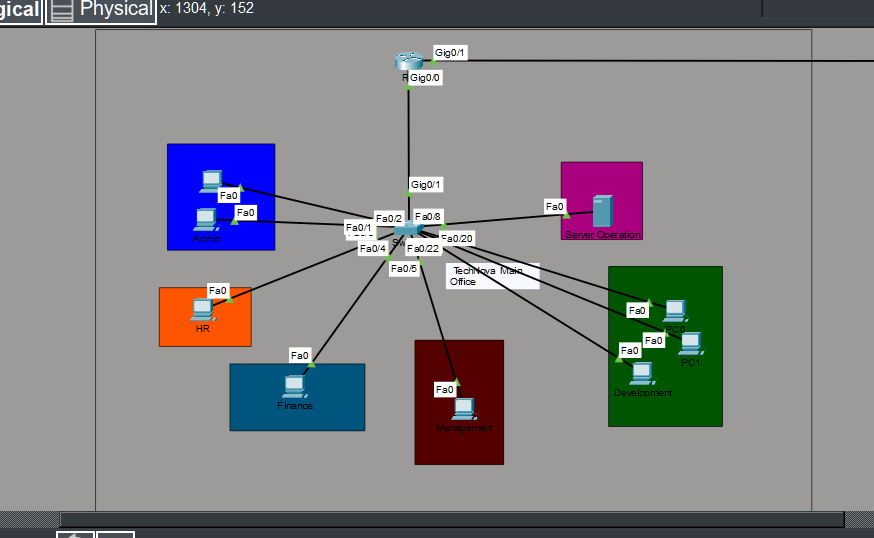
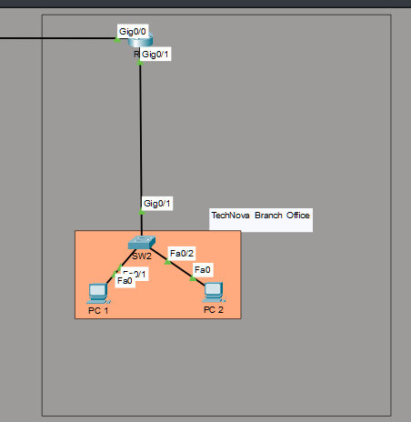

# TechNova Network Lab

Cisco Packet Tracer lab for a multi-floor company network. Coursework assignment — designed, built, and documented entirely by me.

The complete project file ([`technova-lab.pkt`](technova-lab.pkt)) is in this repo — every claim below can be re-verified by opening it in Cisco Packet Tracer and running the shown commands.

## Scenario

TechNova Solutions is a multi-floor office with six departments: Administration, HR, Finance, Management, Development, and Server Operations. The company has a small branch office that must communicate with the main office via dynamic routing. Each department is isolated into its own VLAN, with controlled inter-VLAN communication. Management requires access to all departments and servers.

## Topology

- 2 routers, 2 switches, 11 end devices
- **Main office:** R1 + SW1 + 6 VLANs on router-on-a-stick; 9 end devices across six department groups (Admin 2 · HR 1 · Finance 1 · Management 1 · Development 3 · Server Ops 1)
- **Branch office:** R2 + SW2 + 2 hosts; SW2 is a flat Layer 2 switch (see known limitation below)
- **WAN link:** R1 Gi0/1 ↔ R2 Gi0/0 (`10.0.0.8/30`) running RIP v2
- **Downlinks:** R1 Gi0/0 → SW1 Gi0/1 (802.1Q trunk) · R2 Gi0/1 → SW2




## What I built

- **VLANs:** 10 Administration · 20 HR · 30 Finance · 40 Management · 50 Development · 60 Server Operations
- **Inter-VLAN routing:** router-on-a-stick (6 subinterfaces, Gi0/0.1–Gi0/0.6 on R1)
- **Trunking:** SW1 Gi0/1, 802.1Q, allowed VLANs 10,20,30,40,50,60
- **Dynamic routing:** RIP v2 between R1 and R2
- **Addressing:** /29 **FLSM** — one subnet per VLAN, plus a /30 WAN link (see the design lesson below — the fixed mask was my key mistake)
- **Access control:** extended ACLs 101–103 and 105–106, applied inbound on the matching R1 subinterface, enforce department isolation; **no ACL restricts VLAN 40** — Management reaches everything, per the brief
- **SSH:** enabled on R1, R2, SW1 (`transport input ssh` on vty); the capture below is R1
- **Hardening:** `banner motd`, `service password-encryption`, `enable secret`, port-security with sticky MACs, unused ports administratively shut down

### Addressing (as verified in `show ip route` below)

| Segment | Subnet | Gateway |
|---|---|---|
| VLAN 10 · Administration | 192.168.10.0/29 | .1 |
| VLAN 20 · HR | 192.168.10.8/29 | .9 |
| VLAN 30 · Finance | 192.168.10.16/29 | .17 |
| VLAN 40 · Management | 192.168.10.24/29 | .25 |
| VLAN 50 · Development | 192.168.10.32/29 | .33 |
| VLAN 60 · Server Operations | 192.168.10.40/29 | .41 |
| WAN link R1 ↔ R2 | 10.0.0.8/30 | R1 = .9, R2 = .10 |
| Branch LAN | 192.168.20.0/29 | learned via RIP [120/1] |

### Inter-VLAN policy (as implemented by the ACLs, proven by the ping matrix below)

| Source VLAN | Can reach |
|---|---|
| Any department (10, 20, 30, 50, 60) | Its own VLAN · Management (40) · branch / WAN |
| Management (40) | Everything (unrestricted — requirement: *"management requires access to all departments and servers"*) |

Departments cannot reach each other. The ACL hit counters and the ping results below agree.

## Verification proof

All outputs below were captured from `technova-lab.pkt` in Cisco Packet Tracer.

<details>
<summary>Routing table (R1) — RIP v2 learned the branch network</summary>

```text
R1#show ip route
Codes: L - local, C - connected, S - static, R - RIP, M - mobile, B - BGP
       D - EIGRP, EX - EIGRP external, O - OSPF, IA - OSPF inter area
       N1 - OSPF NSSA external type 1, N2 - OSPF NSSA external type 2
       E1 - OSPF external type 1, E2 - OSPF external type 2, E - EGP
       i - IS-IS, L1 - IS-IS level-1, L2 - IS-IS level-2, ia - IS-IS inter area
       * - candidate default, U - per-user static route, o - ODR
       P - periodic downloaded static route

Gateway of last resort is not set

     10.0.0.0/8 is variably subnetted, 2 subnets, 2 masks
C       10.0.0.8/30 is directly connected, GigabitEthernet0/1
L       10.0.0.9/32 is directly connected, GigabitEthernet0/1
     192.168.10.0/24 is variably subnetted, 12 subnets, 2 masks
C       192.168.10.0/29 is directly connected, GigabitEthernet0/0.1
L       192.168.10.1/32 is directly connected, GigabitEthernet0/0.1
C       192.168.10.8/29 is directly connected, GigabitEthernet0/0.2
L       192.168.10.9/32 is directly connected, GigabitEthernet0/0.2
C       192.168.10.16/29 is directly connected, GigabitEthernet0/0.3
L       192.168.10.17/32 is directly connected, GigabitEthernet0/0.3
C       192.168.10.24/29 is directly connected, GigabitEthernet0/0.4
L       192.168.10.25/32 is directly connected, GigabitEthernet0/0.4
C       192.168.10.32/29 is directly connected, GigabitEthernet0/0.5
L       192.168.10.33/32 is directly connected, GigabitEthernet0/0.5
C       192.168.10.40/29 is directly connected, GigabitEthernet0/0.6
L       192.168.10.41/32 is directly connected, GigabitEthernet0/0.6
     192.168.20.0/29 is subnetted, 1 subnets
R       192.168.20.0/29 [120/1] via 10.0.0.10, 00:00:04, GigabitEthernet0/1
```

</details>

<details>
<summary>Trunk configuration (SW1)</summary>

```text
SW1#show interfaces trunk
Port        Mode         Encapsulation  Status        Native vlan
Gig0/1      on           802.1q         trunking      1

Port        Vlans allowed on trunk
Gig0/1      10,20,30,40,50,60

Port        Vlans allowed and active in management domain
Gig0/1      10,20,30,40,50,60

Port        Vlans in spanning tree forwarding state and not pruned
Gig0/1      10,20,30,40,50,60
```

</details>

<details>
<summary>ACLs (R1) — department isolation, with hit counters from the tests below</summary>

```text
R1#show access-lists
Extended IP access list 101
    10 deny ip 192.168.10.0 0.0.0.7 192.168.10.16 0.0.0.7 (4 match(es))
    20 deny ip 192.168.10.0 0.0.0.7 192.168.10.8 0.0.0.7 (4 match(es))
    30 deny ip 192.168.10.0 0.0.0.7 192.168.10.32 0.0.0.7 (4 match(es))
    40 deny ip 192.168.10.0 0.0.0.7 192.168.10.40 0.0.0.7 (4 match(es))
    50 permit ip any any (4 match(es))
Extended IP access list 102
    10 deny ip 192.168.10.8 0.0.0.7 192.168.10.0 0.0.0.7
    20 deny ip 192.168.10.8 0.0.0.7 192.168.10.16 0.0.0.7
    30 deny ip 192.168.10.8 0.0.0.7 192.168.10.32 0.0.0.7
    40 deny ip 192.168.10.8 0.0.0.7 192.168.10.40 0.0.0.7
    50 permit ip any any
Extended IP access list 103
    10 deny ip 192.168.10.16 0.0.0.7 192.168.10.0 0.0.0.7
    20 deny ip 192.168.10.16 0.0.0.7 192.168.10.8 0.0.0.7
    30 deny ip 192.168.10.16 0.0.0.7 192.168.10.32 0.0.0.7
    40 deny ip 192.168.10.16 0.0.0.7 192.168.10.40 0.0.0.7
    50 permit ip any any
Extended IP access list 105
    10 deny ip 192.168.10.32 0.0.0.7 192.168.10.0 0.0.0.7
    20 deny ip 192.168.10.32 0.0.0.7 192.168.10.8 0.0.0.7
    30 deny ip 192.168.10.32 0.0.0.7 192.168.10.16 0.0.0.7
    40 deny ip 192.168.10.32 0.0.0.7 192.168.10.40 0.0.0.7
    50 permit ip any any
Extended IP access list 106
    10 deny ip 192.168.10.40 0.0.0.7 192.168.10.0 0.0.0.7
    20 deny ip 192.168.10.40 0.0.0.7 192.168.10.8 0.0.0.7
    30 deny ip 192.168.10.40 0.0.0.7 192.168.10.16 0.0.0.7
    40 deny ip 192.168.10.40 0.0.0.7 192.168.10.32 0.0.0.7
    50 permit ip any any
```

The numbering maps one list per restricted VLAN: 101 → VLAN 10, 102 → 20, 103 → 30, 105 → 50, 106 → 60. The absent 104 is the design, not an omission: VLAN 40 (192.168.10.24/29, Management) is the one VLAN the brief says must reach everything, so it is deliberately unrestricted.

</details>

<details>
<summary>Ping matrix from a VLAN 10 host (192.168.10.3) — the ACL policy, proven</summary>

| Target | VLAN | Result | Expected? |
|---|---|---|---|
| 192.168.10.3 | 10 (own) | 4/4 replies | ✅ intra-VLAN works |
| 192.168.10.10 | 20 HR | 100% loss (host unreachable) | ✅ blocked by design |
| 192.168.10.18 | 30 Finance | 100% loss | ✅ blocked by design |
| 192.168.10.26 | 40 Management | 3/4 replies (first timeout = ARP resolution) | ✅ allowed by design |
| 192.168.10.34 | 50 Development | 100% loss | ✅ blocked by design |
| 192.168.10.42 | 60 Server Ops | 100% loss | ✅ blocked by design |

```text
Cisco Packet Tracer PC Command Line 1.0
C:\>ping 192.168.10.3

Pinging 192.168.10.3 with 32 bytes of data:

Reply from 192.168.10.3: bytes=32 time<1ms TTL=128
Reply from 192.168.10.3: bytes=32 time<1ms TTL=128
Reply from 192.168.10.3: bytes=32 time<1ms TTL=128
Reply from 192.168.10.3: bytes=32 time<1ms TTL=128

Ping statistics for 192.168.10.3:
    Packets: Sent = 4, Received = 4, Lost = 0 (0% loss),
Approximate round trip times in milli-seconds:
    Minimum = 0ms, Maximum = 0ms, Average = 0ms

C:\>ping 192.168.10.10

Pinging 192.168.10.10 with 32 bytes of data:

Reply from 192.168.10.1: Destination host unreachable.
Reply from 192.168.10.1: Destination host unreachable.
Reply from 192.168.10.1: Destination host unreachable.
Reply from 192.168.10.1: Destination host unreachable.

Ping statistics for 192.168.10.10:
    Packets: Sent = 4, Received = 0, Lost = 4 (100% loss),

C:\>ping 192.168.10.18

Pinging 192.168.10.18 with 32 bytes of data:

Reply from 192.168.10.1: Destination host unreachable.
Reply from 192.168.10.1: Destination host unreachable.
Reply from 192.168.10.1: Destination host unreachable.
Reply from 192.168.10.1: Destination host unreachable.

Ping statistics for 192.168.10.18:
    Packets: Sent = 4, Received = 0, Lost = 4 (100% loss),

C:\>ping 192.168.10.26

Pinging 192.168.10.26 with 32 bytes of data:

Request timed out.
Reply from 192.168.10.26: bytes=32 time<1ms TTL=127
Reply from 192.168.10.26: bytes=32 time<1ms TTL=127
Reply from 192.168.10.26: bytes=32 time<1ms TTL=127

Ping statistics for 192.168.10.26:
    Packets: Sent = 4, Received = 3, Lost = 1 (25% loss),
Approximate round trip times in milli-seconds:
    Minimum = 0ms, Maximum = 0ms, Average = 0ms

C:\>ping 192.168.10.34

Pinging 192.168.10.34 with 32 bytes of data:

Reply from 192.168.10.1: Destination host unreachable.
Reply from 192.168.10.1: Destination host unreachable.
Reply from 192.168.10.1: Destination host unreachable.
Reply from 192.168.10.1: Destination host unreachable.

Ping statistics for 192.168.10.34:
    Packets: Sent = 4, Received = 0, Lost = 4 (100% loss),

C:\>ping 192.168.10.42

Pinging 192.168.10.42 with 32 bytes of data:

Reply from 192.168.10.1: Destination host unreachable.
Reply from 192.168.10.1: Destination host unreachable.
Reply from 192.168.10.1: Destination host unreachable.
Reply from 192.168.10.1: Destination host unreachable.

Ping statistics for 192.168.10.42:
    Packets: Sent = 4, Received = 0, Lost = 4 (100% loss),

C:\>
```

The four `deny` hit counters on ACL 101 match the four blocked pings above. Note *why* the blocked pings fail the way they do: the replies come from 192.168.10.1 — the router itself, rejecting the packet at the inbound ACL on the source subinterface — instead of a silent timeout. That distinction is the ACL working, not a missing route.

</details>

<details>
<summary>SSH server status (R1)</summary>

```text
R1#show ip ssh
SSH Enabled - version 1.99
Authentication timeout: 120 secs; Authentication retries: 3
```

This proves the SSH server is enabled and running on R1. It is a server-status capture, not a login session — no session transcript is claimed.

</details>

## Design lessons learned

### The /29 FLSM mistake

I divided every VLAN using /29 subnets — 8 addresses, 6 usable. One usable address goes to the router subinterface gateway. That leaves **5 usable hosts per VLAN**, no matter how many the department has.

| VLAN | Department | Devices | Usable |
|---|---|---|---|
| 10 | Administration | 2 | 5 |
| 20 | HR | 1 | 5 |
| 30 | Finance | 1 | 5 |
| 40 | Management | 1 | 5 |
| 50 | Development | 3 | 5 |
| 60 | Server Operations | 1 | 5 |

Development is at 3 of 5 — two more hires and the VLAN is full. The right design starts from host count per department plus a growth margin and uses **VLSM** to size each subnet properly. FLSM /29 was a shortcut that fit the assignment but would fail in a real office. This was the single most valuable mistake in the project: **subnet design starts from the host count, not from a convenient mask.**

### Branch office limitation

SW2 operates as a flat Layer 2 switch in the branch office. Functional for this assignment's scope; a production deployment would mirror the main office's VLAN segmentation and port-security hardening. Documented as a known limitation, not hidden.

### What Packet Tracer simulated

Packet Tracer is a simulator. It does not model real CPU load, real cable faults, or real switch ASIC behavior. All results here are simulation results — stated plainly, because a lab report that overstates its environment overstates everything.

## Reproduce

1. Open [`technova-lab.pkt`](technova-lab.pkt) in Cisco Packet Tracer (8.x).
2. Run any command shown above on the named device.
3. The outputs should match. The ACL hit counters ship at the values of the single captured run (4 matches per `deny` on ACL 101); repeating the ping matrix increments them by 4 per pass — that increment is expected, not a mismatch.

## Tools

Cisco Packet Tracer.

## License

MIT — see [LICENSE](LICENSE).
